# SDLCOrchestrAI

**Agentic skills that carry a feature from idea to GitHub backlog with security built in.**

SDLCOrchestrAI is a portable skill pack for AI coding agents. It turns the early, high-leverage phases of
delivery (requirements, system design, threat modeling, backlog creation, and security review) into
repeatable, reviewable workflows. It is tuned for **.NET API + React + PostgreSQL** projects that track work in **GitHub Issues**, and it
runs in **Claude Code, GitHub Copilot, Cursor, OpenCode, and Google Antigravity (client and IDE)** from a single source of truth.

> New here? Start with [GETTING_STARTED.md](GETTING_STARTED.md).

---

## Contents
- [Why this exists](#why-this-exists)
- [How it works](#how-it-works)
- [Skills](#skills)
- [Repository layout](#repository-layout)
- [Supported clients](#supported-clients)
- [Quick start](#quick-start)
- [Backlog to GitHub](#backlog-to-github)
- [Large requirements: packs and splitting](#large-requirements-packs-and-splitting)
- [Shared memory and switching clients](#shared-memory-and-switching-clients)
- [Security tooling](#security-tooling)
- [Continuous integration](#continuous-integration)
- [Customization](#customization)
- [Design principles and guardrails](#design-principles-and-guardrails)
- [Known limitations](#known-limitations)
- [Troubleshooting](#troubleshooting)

## Why this exists
Mistakes made in requirements and design multiply downstream. Agents are fast at writing code, but without
structure they skip the thinking that prevents rework: unclear requirements, undocumented decisions,
oversized stories, and security flaws that only surface at review time.

This pack gives agents a disciplined workflow with human approval gates, deterministic scripts for
everything that must be reliable, and shared conventions so every client behaves the same way.

## How it works
Five skills form the core delivery chain. Each produces an artifact that the next one consumes. **Every arrow is a human approval gate.** A sixth skill, `sdlc-session-handoff`, keeps shared memory in the repo so you can switch clients mid-feature without rescanning or starting over.

```mermaid
flowchart LR
  A[Feature request] --> B[sdlc-requirements-analyzer]
  B -->|docs/requirements| C[sdlc-system-design]
  C -->|docs/design + ADRs| D[sdlc-security-review<br/>Mode A: threat model]
  D --> E[sdlc-backlog-breakdown]
  E -->|backlog.json| F[push-backlog.sh<br/>dry-run, then apply]
  F --> G[GitHub issues]
  G --> H[sdlc-feature-implementer<br/>branch + TDD + code + draft PR]
  H --> I[sdlc-security-review<br/>Mode B + CI scans]
  I --> J[Merge]
```



Traceability runs end to end: `REQ-012` -> design section -> `E1-S3` -> GitHub issue `#123` -> pull request.

## Skills
| Skill | Purpose | Main output |
|---|---|---|
| `sdlc-requirements-analyzer` | Turns a request, ticket, or notes into structured, testable requirements with IDs; organizes large requirements as a pack of vertical slices; splits an existing large document into slices | `docs/requirements/<feature>.md` or a pack `docs/requirements/<feature>/` |
| `sdlc-system-design` | Produces architecture, data model, API contracts, NFR treatment, rollout plan, and ADRs | `docs/design/<feature>.md`, `docs/adr/*.md` |
| `sdlc-backlog-breakdown` | Splits an approved design into epics, vertical-slice stories, tasks, and spikes; creates GitHub issues | `docs/backlog/<feature>-backlog.{md,json}` |
| `sdlc-feature-implementer` | Guides the implementation of approved backlog stories: branch checkout, TDD test scaffolding mapped to REQ-IDs, clean code (.NET/React/PostgreSQL), local build/test verification, PR draft | Feature branch, tests, code, draft PR |
| `sdlc-security-review` | STRIDE threat modeling at design time; OWASP-class code review of diffs, PRs, or repos | `docs/security/*-threats.md`, `*-review.md`, `*-findings.json` |
| `sdlc-session-handoff` | Shared, client-neutral memory: resume where the last client stopped, checkpoint at gates, codebase map, knowledge graph | `.sdlc/state.json`, `.sdlc/HANDOFF.md`, `.sdlc/memory/*` |

The `sdlc-` prefix keeps these skills easy to tell apart from other skills installed in the same client.

## Repository layout
```
AGENTS.md                      Shared instructions for all clients (workflow, gates, safety rules)
CLAUDE.md                      Pointer to AGENTS.md (Claude Code)
GETTING_STARTED.md             Step-by-step onboarding
scripts/                       CLI tools and cross-platform runners
  sdlc.py                      Universal zero-dependency Python 3 runner (check-env, story, verify, sync)
  sdlc.cmd, sdlc.ps1, sdlc     Native Windows CMD, PowerShell, and POSIX launchers
  sync-skills.sh               Publishes skills to each client; --check detects drift
skills/                        Canonical skills (edit here)
  sdlc-requirements-analyzer/  SKILL.md, references/, templates/, scripts/ (req-index.sh)
  sdlc-system-design/          SKILL.md, references/, templates/
  sdlc-backlog-breakdown/      SKILL.md, references/, templates/, scripts/
  sdlc-feature-implementer/    SKILL.md, references/, templates/ (TDD scaffolds, PR templates)
  sdlc-security-review/        SKILL.md, references/, scripts/
  sdlc-session-handoff/        SKILL.md, references/, templates/, scripts/ (state, graph)
.sdlc/config.yaml              GitHub repo and optional Projects settings
.sdlc/schema/                  backlog, state, and graph schemas
.sdlc/state.json, HANDOFF.md    Shared cross-client memory (committed; generated by scripts)
.sdlc/memory/                  codebase-map.md and graph.jsonl (knowledge graph)
.github/workflows/             security.yml, sync-check.yml
.github/copilot-instructions.md  Pointer to AGENTS.md (Copilot)
docs/                          Where agents write requirements, designs, ADRs, backlogs, security reports
```
Generated locally on demand via `sdlc sync-skills`: `.claude/skills/`, `.github/skills/`, `.opencode/skills/`, `.agent/skills/`, `.cursor/rules/`.

## Supported clients
| Client | Instructions | Skills |
|---|---|---|
| Claude Code | `CLAUDE.md` -> `AGENTS.md` | `.claude/skills/` |
| GitHub Copilot (VS Code agent mode) | `.github/copilot-instructions.md`, `AGENTS.md` | `.github/skills/` |
| Cursor | `AGENTS.md` | `.cursor/rules/*.mdc` (stubs that point to `skills/<name>/SKILL.md`) |
| OpenCode | `AGENTS.md` | `.opencode/skills/` (also reads `.claude/skills/`) |
| Google Antigravity (IDE and client) | `AGENTS.md` (cross-tool; `GEMINI.md` is Antigravity-only and takes precedence if present) | `.agent/skills/` |

Client folder conventions change between releases. Verify them against each tool's current documentation.

## Quick start
```bash
# 1. Check your environment prerequisites:
scripts/sdlc.cmd check-env   # Windows (or ./scripts/sdlc check-env on macOS/Linux)

# 2. Set your repository in .sdlc/config.yaml (github.repo: owner/name)
gh auth login

# 3. Synchronize skills to your client:
scripts/sdlc.cmd sync-skills # (or bash scripts/sync-skills.sh)
```
Then ask your agent: *"Here's the feature request: ... Turn it into requirements."*
The full walkthrough is in [GETTING_STARTED.md](GETTING_STARTED.md).

**Prerequisites:** Python 3 (standard runtime), `git`, and the GitHub CLI `gh`. Optional scanners: `gitleaks`, `semgrep`, `dotnet`, `npm`. Works natively across Windows, macOS, and Linux.

## Story implementation (Story to PR)
Once issues are pushed to GitHub, use `sdlc-feature-implementer` to write code against approved acceptance criteria:

```bash
# 1. View story card, Given/When/Then criteria, and design references:
sdlc story show E1-S1

# 2. Start the story branch:
sdlc story start E1-S1
# Automatically creates feat/<issue-id>-<slug> and records checkpoint in .sdlc/state.json

# 3. Scaffold tests directly from Given/When/Then acceptance criteria (TDD).
# 4. Implement minimal clean code (.NET API / React / PostgreSQL).
# 5. Verify locally:
dotnet test
sdlc verify --gate implementation

# 6. Generate PR description draft:
sdlc story pr-body E1-S1 > .sdlc/pr-body.md
gh pr create --body-file .sdlc/pr-body.md
```

## Backlog to GitHub
The backlog skill emits a tracker-neutral JSON file validated by `.sdlc/schema/backlog.schema.json`.
A deterministic script publishes it, so issue creation never depends on the model typing CLI commands.

```bash
bash skills/sdlc-backlog-breakdown/scripts/push-backlog.sh --file docs/backlog/<feature>-backlog.json --dry-run
bash skills/sdlc-backlog-breakdown/scripts/push-backlog.sh --file docs/backlog/<feature>-backlog.json
```

- **Dry run first, always.** Nothing is created without an approved plan.
- **Idempotent.** Titles are prefixed `[<id>]`; re-runs update existing issues instead of duplicating them.
- **Linked.** Stories become sub-issues of their epic where GitHub supports it, with a "Part of #N" fallback in the body.
- **Labeled.** `epic`, `type:*`, `priority:*`, `estimate:*`, plus any custom labels are created automatically.
- **Traceable.** Issue numbers and URLs are written back into the JSON; commit it.
- `scripts/pull-backlog.sh` lists existing issues so agents can avoid duplicates.
- For requirements packs, backlogs are created per slice (`docs/backlog/<feature>/<slice>-backlog.json`, one epic per slice, slice-prefixed IDs) and pushed independently.

## Large requirements: packs and splitting
One bulky `<feature>.md` forces every phase to load everything and makes review all-or-nothing. For large features, requirements are organized as a
**pack of vertical slices**, and an existing large document can be split into one automatically.

```
docs/requirements/<feature>/
  00-index.md      overview, goals, scope, and a generated table of slices (read this first)
  glossary.md      shared terms
  nfr.md           cross-cutting requirements (security baseline, availability, retention, accessibility)
  slices/01-<capability>.md ...   one vertical slice each: its own REQ-<PREFIX>-NNN IDs, rules, acceptance, open questions
  index.json       generated manifest (IDs, file, status, size, content hash)
  pack.json, _source/, _split-report.md, id-map.json   present when created by a split
```

| Rule | Why |
|---|---|
| Single file up to about 40 requirements or 400 lines; pack above that | Small features stay simple (global `REQ-001` IDs); packs use slice-prefixed IDs (`REQ-PREF-001`) |
| Slice by user-visible capability, not by document type or layer | Keeps traceability: one slice becomes one epic |
| Shared requirements live once in `nfr.md` | No copies drifting apart |
| Agents read the index, then one slice (`show --slice` or `--id`) | Fits context budgets; resuming clients do not reload everything |
| Approve per slice; edits after approval are flagged stale | Start designing slice 1 while slice 3 is still being clarified |

```bash
R=skills/sdlc-requirements-analyzer/scripts/req-index.sh
bash $R analyze  --file docs/requirements/_incoming/big.md                   # size, outline, ID stats, pack-or-not
bash $R skeleton --file docs/requirements/_incoming/big.md --feature billing --out docs/requirements/billing.split-plan.json
bash $R split    --plan docs/requirements/billing.split-plan.json --dry-run   # must show 0 unassigned lines
bash $R split    --plan docs/requirements/billing.split-plan.json             # writes the pack verbatim; original kept in _source/
bash $R build    --feature billing && bash $R validate --feature billing
bash $R show     --feature billing --slice payments                          # or --id REQ-PAY-003 or --index
```

Splitting is deterministic and lossless: lines are copied verbatim with provenance comments, a coverage check fails on any unassigned or overlapping
line, and the original is preserved. Legacy IDs can be kept or renumbered to slice-prefixed IDs (with `id-map.json`). Full instructions:
[GETTING_STARTED.md](GETTING_STARTED.md#5-large-requirements-slices-and-splitting-an-existing-document) and
`skills/sdlc-requirements-analyzer/references/splitting-existing-docs.md`. Design, backlog, and security work then proceed one slice at a time.

## Shared memory and switching clients
Client-native memory is siloed, so a new client normally starts cold and rescans the repo. SDLCOrchestrAI stores project memory
**in the repo**, in plain files every client can read and any script can update, so work continues where the previous client stopped.

| Layer | File | What it holds |
|---|---|---|
| Handoff state | `.sdlc/state.json`, `.sdlc/HANDOFF.md` | Per-feature phase, gate statuses, exact next action, open questions, artifacts, who wrote last and at which commit |
| Codebase map | `.sdlc/memory/codebase-map.md` | Compact repo map stamped with a commit, so only changed paths are re-read |
| Knowledge graph | `.sdlc/memory/graph.jsonl` | REQ, design section, story, task, issue, PR, threat, and finding with their links; supports gap queries |

```bash
bash skills/sdlc-session-handoff/scripts/sdlc-state.sh resume                 # start of every session
bash skills/sdlc-session-handoff/scripts/sdlc-state.sh checkpoint --client opencode --feature np \
     --phase design --gate design=in-review --next "Human review, then threat model"   # at each gate
bash skills/sdlc-session-handoff/scripts/sdlc-state.sh map-status             # which paths changed since the map was stamped
bash skills/sdlc-session-handoff/scripts/sdlc-graph.sh gaps                    # uncovered requirements, unmitigated high threats
```
How a switch works: Client A checkpoints and you commit `.sdlc/`. Client B runs `resume`, sees the handoff note, the commits and files that
changed since, and whether the map is stale, then continues from the recorded next action without redoing approved gates.

Rules: memory is a hint, not truth (verify against the repo); no secrets or personal data; write only through the scripts; a recorded approval
never authorizes new side effects. CI validates both files (`sync-check.yml`). Details: `skills/sdlc-session-handoff/references/state-protocol.md`.

## Security tooling
| Script | What it checks | Tools used |
|---|---|---|
| `scan-secrets.sh` | Committed secrets | gitleaks, else trufflehog, else a regex fallback |
| `scan-deps.sh` | Vulnerable NuGet and npm dependencies | `dotnet list package --vulnerable`, `npm audit` |
| `scan-sast.sh` | Static analysis (C#, TypeScript/React, OWASP rules) | Semgrep |

All scripts write to `.sdlc/reports/`, never print secret values, and skip (rather than install) missing tools.
Set `SDLC_STRICT=1` to exit non-zero on findings. The `sdlc-security-review` skill interprets the results and adds
manual review against OWASP and stack-specific checklists (ASP.NET Core, EF Core/Npgsql, React, PostgreSQL).

## Continuous integration
- `.github/workflows/security.yml`: gitleaks, dependency audit, and CodeQL (C# and JavaScript/TypeScript) on pull requests, pushes to `main`, and weekly.
- `.github/workflows/sync-check.yml`: fails a PR if client skill copies drift from `skills/`.

Set the .NET and Node versions in `security.yml` and consider pinning third-party actions to commit SHAs.
CI is the enforcement layer; the skills help agents understand and fix what CI reports.

## Customization
The biggest quality lever is your own context. Edit the files under `skills/` (never the generated copies), then run `scripts/sync-skills.sh`.

- `skills/sdlc-system-design/references/design-principles.md`: your architecture standards, patterns, and NFR targets.
- `skills/sdlc-security-review/references/`: your threat categories, compliance needs, and stack rules.
- `skills/sdlc-backlog-breakdown/references/`: add two or three examples of good stories from your team.
- `AGENTS.md`: conventions, branching, commit style, and any additional approval gates.
- `.sdlc/config.yaml`: repository and GitHub Projects settings.

## Design principles and guardrails
1. **Human gates between phases.** Mistakes in requirements and design are the most expensive to fix later.
2. **Scripts for determinism, models for judgment.** Scanning, validation, and issue creation are scripted; the agent decides and interprets.
3. **One source of truth.** Edit `skills/`; generate everything else; CI detects drift.
4. **No silent side effects.** No issue creation, destructive commands, or code changes without explicit approval.
5. **Secrets never printed.** Reports reference `file:line` only.
6. **Static review only.** No exploitation or probing of live systems.
7. **Unknowns are written down.** Open questions are recorded, never guessed.

## Known limitations
- Estimates are written as `estimate:N` labels; mapping to a GitHub Projects number field needs your project's field IDs.
- Sub-issues and issue dependencies depend on your GitHub plan and organization settings.
- Semgrep fetches rules from its registry (network required); CodeQL in CI is the primary SAST gate.
- The scripts are Bash and require `jq`; Windows users need Git Bash or WSL.
- Splitting works on Markdown with headings and line ranges. Convert Word/PDF/wiki exports first (for example `pandoc`), and review the split report for dangling cross-references; the tool never rewrites requirement wording.
- Requirement-ID detection is regex-based; unusual ID styles need `--id-regex`.
- Shared memory assumes one active writer per feature at a time; `state.json` conflicts are resolved by hand (see `state-protocol.md`).
- Only GitHub is implemented as a tracker. The neutral JSON schema keeps the door open for other adapters.
- Skill behavior varies by client and model; test on a past feature whose outcome you already know before relying on it.

## Troubleshooting
| Symptom | Likely cause and fix |
|---|---|
| Agent does not use a skill | Check the client's skills folder was synced and committed; make the request more specific; confirm the skill appears when you ask the agent which skills it has. |
| Antigravity SDK/CLI wrappers use `.agents/` instead of `.agent/` | Run `SDLC_SYNC_EXTRA=".agents/skills" bash scripts/sync-skills.sh` (use the same variable with `--check` in CI). |
| `split` fails with unassigned or overlapping lines | Every non-blank source line must belong to exactly one slice, cross-cutting target, or `skip` range. Fix the ranges in the plan (line numbers come from `analyze`). |
| `analyze` finds no requirement IDs | The document uses another ID style. Pass `--id-regex '<ERE>'` (extended regex, no backslashes) or add IDs first. |
| A slice is reported STALE | It was edited after its approval checkpoint. Re-review its design and backlog, then checkpoint again with `--slice`. |
| New client does not pick up where the last stopped | Make sure `.sdlc/` was committed and pulled; run `sdlc-state.sh resume`; if it warns the recorded commit is missing, fetch or check out the right branch. |
| Duplicate skills in OpenCode | OpenCode reads `.claude/skills/` too. Remove the `.opencode/skills` line from `scripts/sync-skills.sh` and delete that folder. |
| `gh: not authenticated` | Run `gh auth login`. For Projects, run `gh auth refresh -s project`. |
| `jq is required` | Install jq (`brew install jq`, `apt install jq`, `winget install jqlang.jq`). |
| Sub-issue link skipped | Feature unavailable on your plan or already linked; the "Part of #N" text is still in the issue body. |
| CI sync check fails | Run `bash scripts/sync-skills.sh` and commit the result. |

---
*Maintained by the SDLCOrchestrAI team. Add your license and contribution guidelines here.*
