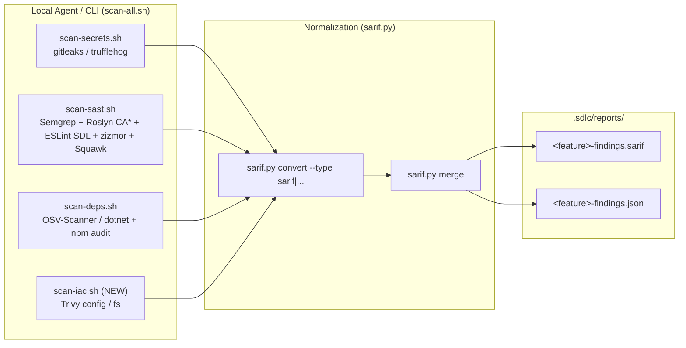

# Design & Rollout Plan: Open-Source Security Tooling Expansion

**Status:** Proposed  
**Target Stack:** .NET API + React (TypeScript) + PostgreSQL + GitHub Actions  
**Scope:** `skills/sdlc-security-review/`, `scripts/sdlc.py`, `.sdlc/config.yaml`, `.github/workflows/security.yml`, `README.md`, `GETTING_STARTED.md`

---

## 1. Problem & Current Baseline

SDLCOrchestrAI currently provides deterministic local/CI scanning and SARIF 2.1.0 merging via:
- **Secrets:** `gitleaks` (primary), `trufflehog` (fallback), regex heuristics (`scan-secrets.sh`)
- **SAST:** `Semgrep` (local/CI), `CodeQL` (CI only), regex heuristics (`scan-sast.sh`)
- **Dependencies:** `dotnet list package --vulnerable` and `npm audit` (`scan-deps.sh`)
- **Normalization:** `skills/sdlc-security-review/scripts/sarif.py` -> `.sdlc/reports/<feature>-findings.{sarif,json}`

### Key Gaps
1. **No Container / IaC / Config Scanning:** `Dockerfile`, `docker-compose.yml`, Terraform/K8s, and cloud configs are unscanned.
2. **No GitHub Actions Supply-Chain Check:** `.github/workflows/*.yml` are not scanned for script injection, excessive `GITHUB_TOKEN` permissions, or unpinned action tags.
3. **Weak Local .NET & React SAST Parity:** `CodeQL` runs only in GitHub Actions; locally, agents rely on Semgrep + regex without compiler-backed C# dataflow or React DOM-XSS ESLint rules.
4. **Online/Restore-Coupled Dependency Checks:** `dotnet list package --vulnerable` requires a full restore and lacks native SARIF; `npm audit` and `dotnet` use separate parsers in `sarif.py`.
5. **No PostgreSQL Migration Linting:** Raw `.sql` migrations are not checked for unsafe DDL locks or risky `GRANT`/`SECURITY DEFINER` statements.
6. **Manual-Only Threat Modeling & Static-Only API Checks:** Mode A threat modeling has no optional threat-model-as-code helper, and teams with ephemeral Docker CI environments have no automated OpenAPI DAST check.

---

## 2. Design Principles

1. **SARIF-First Ingestion:** Add a single `--type sarif` converter to `sarif.py` instead of writing custom JSON parsers for every new tool. Any tool that emits SARIF 2.1.0 plugs in with minimal shell glue.
2. **Graceful Degradation:** Every new scanner must follow the existing `ran` | `fallback` | `skipped` contract in `<feature>-findings.json` so missing local tools never break `scan-all.sh`.
3. **Zero Mandatory Local Bloat:** Heavy or CI-only tools (e.g., OWASP ZAP) stay strictly optional or CI-scoped; local agent runs remain fast.
4. **Config-Driven & Backwards-Compatible:** All new scanners are configurable via `.sdlc/config.yaml` (`security:` block). If `security:` is omitted, existing repos default to `auto` (run if installed, `skipped` if absent).
5. **Safety Compliance:** Preserve `AGENTS.md` rules—no secret values in reports, no live/production probing, and `python scripts/sdlc.py sync-skills` after editing `skills/`.

---

## 2.5 Configuration Design (`.sdlc/config.yaml`)

All security scanners and CI/optional extensions are configured under a top-level `security:` key in `.sdlc/config.yaml`.

```yaml
security:
  strict: false                 # true = exit 1 on any finding (overridden by SDLC_STRICT=1 or --strict)
  exclude_paths:
    - node_modules
    - bin
    - obj
    - dist
    - build
  scanners:
    # Mode: auto (run if installed, skip otherwise) | enabled (warn/fail if missing) | disabled (skip)
    gitleaks: auto
    semgrep: auto
    trivy: auto                 # Phase 1: IaC / container / fs
    osv_scanner: auto           # Phase 1: lockfile SCA (NuGet, npm, PyPI)
    zizmor: auto                # Phase 1: GitHub Actions workflows
    roslyn: auto                # Phase 2: .NET CA* / SCS* SARIF during build
    eslint_sdl: auto            # Phase 2: React ESLint SDL (when configured in package.json)
    squawk: auto                # Phase 2: PostgreSQL migration SQL linter
  roslyn_rule_prefixes:
    - CA21
    - CA30
    - CA53
    - CA54
    - SCS
  optional:
    pytm: false                 # Phase 3: Mode A threat-model-as-code helper
    zap_ci_dast: false          # Phase 3: CI-only ephemeral OpenAPI DAST
```

### Precedence & Parsing
- **Precedence:** CLI flags (`--strict`, `--feature`) > Environment variables (`SDLC_STRICT`, `SDLC_FEATURE`) > `.sdlc/config.yaml` (`security.*`) > built-in defaults (`auto`, `strict: false`).
- **Implementation:** `scripts/sdlc.py` (or a small stdlib helper invoked by `_scan_common.sh`) reads `.sdlc/config.yaml` and exports `SDLC_SEC_<TOOL>=auto|enabled|disabled` to `scan-*.sh` scripts so Bash scripts stay dependency-free.
- **Disabled vs. Missing:** A tool set to `disabled` is recorded in `<feature>-findings.json` with `status: "skipped"` and `message: "disabled in .sdlc/config.yaml"`, keeping audit trails explicit.

---

## 3. Target Architecture



---

## 4. Phased Implementation Plan

### Phase 0 — Foundation: Generic SARIF Ingestion (Prerequisite)
**Goal:** Allow `sarif.py` to ingest any external tool's SARIF 2.1.0 output directly into the normalized schema.

| Item | Details |
|---|---|
| **Code change** | Add `--type sarif` converter in `skills/sdlc-security-review/scripts/sarif.py` mapping SARIF `runs[].results[]` (`ruleId`, `level`, `message.text`, `locations[].physicalLocation`) to `.sdlc/schema/findings.schema.json`. |
| **Tests** | Add unit tests in `scripts/tests/` using sample SARIF 2.1.0 fixtures (verifying severity mapping, relative paths, and zero secret leakage). |
| **Effort** | Small (1 PR) |

---

### Phase 1 — High-Impact Quick Wins (IaC, Supply Chain, Unified SCA)
**Goal:** Cover containers, IaC, lockfiles, and GitHub Actions workflows with single-binary Apache/MIT tools.

| Tool | Role | Integration Point | Fallback / Behavior |
|---|---|---|---|
| **Trivy** (`aquasecurity/trivy`) | IaC (`Dockerfile`, Compose, Terraform/K8s) + filesystem/lockfile vulnerabilities | New `skills/sdlc-security-review/scripts/scan-iac.sh` (`trivy config --format sarif`) + wired into `scan-all.sh` and `.github/workflows/security.yml` | If `trivy` not installed -> `status: skipped` with install hint. |
| **OSV-Scanner** (`google/osv-scanner`) | Lockfile-first SCA across NuGet (`packages.lock.json`), npm (`package-lock.json`), PyPI | `scan-deps.sh` runs `osv-scanner --format sarif` when available, complementing or falling back to `dotnet list package` / `npm audit`. | Existing `dotnet` + `npm audit` remain intact if `osv-scanner` is absent. |
| **zizmor** (`woodruffw/zizmor`) | GitHub Actions workflow security (script injection, token scope, unpinned actions) | `scan-sast.sh` runs `zizmor --format sarif .github/workflows/` when `.github/workflows/` exists; add dedicated job in `security.yml`. | `status: skipped` if not installed. |
| **CI Hardening** | Pin third-party actions in `.github/workflows/security.yml` to commit SHAs | Update `security.yml` and validate with `zizmor`. | N/A |

**Exit Criteria:**
- `scan-all.sh --feature ci` produces merged SARIF containing Trivy, OSV-Scanner, and zizmor results when installed, and cleanly marks `skipped` when absent.
- `python scripts/sdlc.py check-env` reports availability of `trivy`, `osv-scanner`, and `zizmor` as optional security tools.

---

### Phase 2 — Stack-Specific Depth (.NET + React + PostgreSQL)
**Goal:** Give local AI agents compiler-backed C# analysis, React DOM-XSS checks, and PostgreSQL migration linting without waiting for CI CodeQL.

| Tool | Stack Target | Integration Point | Notes |
|---|---|---|---|
| **Roslyn Security Rules** (`Microsoft.CodeAnalysis.NetAnalyzers` `CA*` + optional `SecurityCodeScan.VS2019`) | .NET API (`*.csproj` / `*.sln`) | `scan-sast.sh` (opt-in flag or auto when `.sln`/`.csproj` exists): `dotnet build --no-restore /p:ErrorLog=<out>.sarif,version=2.1` | Zero new binary; native SARIF 2.1.0. Filter to security rule prefixes (`CA21*`, `CA30*`, `CA53*`, `CA54*`, `SCS*`) in `sarif.py` or post-filter so non-security style warnings don't pollute security reports. |
| **ESLint Security** (`@microsoft/eslint-plugin-sdl` + `eslint-plugin-no-unsanitized`) | React / TypeScript | Document recommended ESLint config in `skills/sdlc-security-review/references/dotnet-react-postgres.md`; `scan-sast.sh` ingests SARIF if `@microsoft/eslint-formatter-sarif` is configured in the target repo. | Avoids forcing npm packages into repos that don't use them; runs only if already present in `package.json`. |
| **Squawk** (or **SQLFluff**) | PostgreSQL migrations (`*.sql`) | `scan-sast.sh` runs `squawk` on changed/staged `.sql` migration files if installed. | Catches table-locking DDL and unsafe schema changes during PR review. |

**Exit Criteria:**
- Updated `skills/sdlc-security-review/references/dotnet-react-postgres.md` and `references/sarif.md` documenting each scanner, its rule prefixes, and fallback behavior.
- `python scripts/sdlc.py sync-skills` run and verified by `.github/workflows/sync-check.yml`.

---

### Phase 3 — Optional Extensions (Mode A Threat-Model-as-Code & Ephemeral CI DAST)
**Goal:** Strengthen design-time threat modeling and runtime OpenAPI verification without violating static-only local rules.

| Tool | Phase | Integration Point | Guardrails |
|---|---|---|---|
| **OWASP pytm** | Mode A (Design) | Optional helper script or template referenced in `skills/sdlc-security-review/references/threat-model-stride.md` to generate DFDs + STRIDE threat tables from Python model definitions. | Markdown `docs/security/<feature>-threats.md` remains the canonical human-reviewable artifact. |
| **OWASP ZAP** (`zap-api-scan.py`) | CI-Only PR Gate | Optional commented/opt-in job in `.github/workflows/security.yml` using `zaproxy/action-api-scan` against an ephemeral Docker Compose test container + `openapi.json`. | **Never** run against staging/production URLs; strictly ephemeral CI containers. Outputs SARIF to GitHub Code Scanning. |
| **Syft** (or Trivy SBOM) | Release CI | Optional release-workflow step generating CycloneDX/SPDX SBOM artifacts. | Artifact upload only; no blocking gate unless configured by downstream repo. |

---

## 5. Documentation Updates (`README.md` & `GETTING_STARTED.md`)

Every phase that ships new configurable scanners must update both user-facing entry docs:

| File | Sections to Update | What to Document |
|---|---|---|
| `README.md` | **Guardrails & CI**, **Documentation map** | List the supported open-source security tools (Gitleaks, Semgrep, CodeQL, Trivy, OSV-Scanner, zizmor, Roslyn analyzers, ESLint SDL, Squawk, optional pytm/ZAP) and note that they are configurable in `.sdlc/config.yaml` under `security:`. |
| `GETTING_STARTED.md` | **1. Prerequisites**, **2. Install & Sync**, **4. Daily Cheat Sheet**, **5. Advanced Workflows** | Update optional tools list; show the `security:` snippet for `.sdlc/config.yaml` (`auto` / `enabled` / `disabled`); explain how `python scripts/sdlc.py check-env` reports available vs. missing scanners and how to enable/disable scanners per project. |

---

## 6. Risks & Mitigations

| Risk | Impact | Mitigation |
|---|---|---|
| **Tooling noise / false positives** (e.g., Roslyn `CA*` non-security warnings) | Alert fatigue for agents and reviewers | Filter Roslyn SARIF to security rule IDs (`CA21xx`, `CA30xx`, `CA53xx`, `CA54xx`, `SCS*`); keep `scan-all.sh` non-blocking by default (`SDLC_STRICT=1` opt-in). |
| **Cross-platform friction (Windows vs. Linux/macOS)** | `bash` scripts failing on Windows paths | Keep `sarif.py` pure Python stdlib; normalize Windows backslashes to forward-slash repo-relative paths in `--type sarif`. |
| **Slow local agent runs** | `dotnet build` or `trivy` slowing down Mode B reviews | Only run `dotnet build` Roslyn check when `.csproj` exists and `--deep` (or CI) is set, or reuse existing build outputs; skip missing tools cleanly. |
| **Supply-chain risk in CI itself** | Compromised third-party GitHub Action | Pin all actions in `.github/workflows/security.yml` to full commit SHAs and enforce with `zizmor`. |

---

## 7. Verification Checklist (Before Merging Each Phase)

- [ ] `python -m unittest discover -s scripts/tests -v` passes (including new `sarif.py --type sarif` and `.sdlc/config.yaml` `security:` parsing tests).
- [ ] `bash skills/sdlc-security-review/scripts/scan-all.sh --feature verify` succeeds with tools installed, with tools absent (`skipped`), and with tools set to `disabled` in `.sdlc/config.yaml`.
- [ ] `python scripts/sdlc.py sarif` / `sarif.py validate .sdlc/reports/verify-findings.sarif` passes SARIF 2.1.0 schema checks.
- [ ] `python scripts/sdlc.py sync-skills` run so `.agent/`, `.claude/`, `.github/`, `.cursor/`, `.opencode/` stay in sync.
- [ ] `README.md` and `GETTING_STARTED.md` reflect the newly added configurable tools and `.sdlc/config.yaml` options.
- [ ] `.github/workflows/security.yml` passes `zizmor` with zero high/critical findings.
