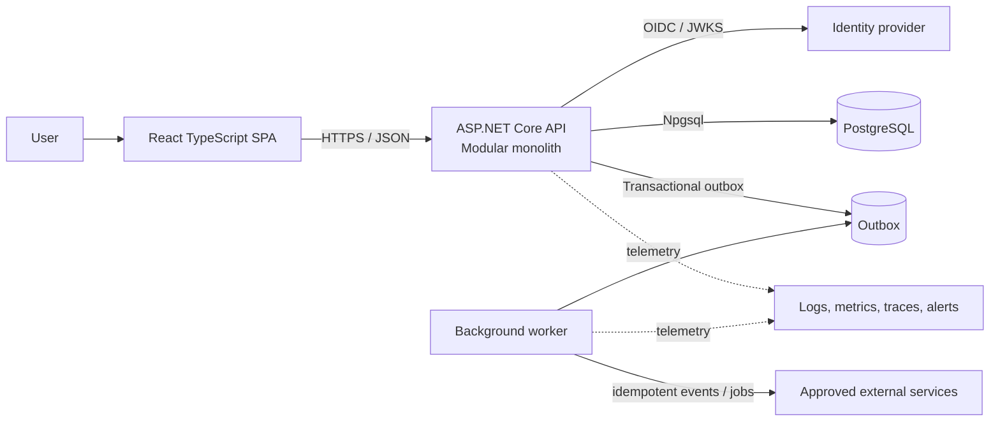

# Architecture Standards — .NET API, React, and PostgreSQL

**Status:** Proposed baseline  
**Applies to:** New features and significant changes in this product  
**Review cadence:** At design review and before production release

## 1. Purpose and design stance

This standard provides a practical, enforceable architecture baseline for a React web application, ASP.NET Core API, and PostgreSQL data store. It is intentionally biased toward a **modular monolith**: one deployable application with explicit business-module boundaries. Services are extracted only when an independently deployable boundary, independent scale profile, isolation need, or team ownership model is demonstrated.

### Architecture principles

1. **Business boundaries first.** Modules map to capabilities (for example, Expenses, Budgets, Reporting), not technical layers or tables.
2. **Own data explicitly.** Each table and schema has one owning module. Other modules use the owner’s application interface or published events; they never query its tables directly.
3. **Secure and observable by default.** Authentication, authorization, auditability, telemetry, and safe failure modes are part of every feature.
4. **Prefer simple synchronous paths.** Use asynchronous messaging only when decoupling, retry isolation, burst smoothing, or long-running work is genuinely required.
5. **Design for change.** Use backward-compatible contracts, forward-only database migrations, feature flags, and ADRs for hard-to-reverse choices.
6. **Measure outcomes.** NFRs have explicit targets, dashboards, and release checks—not aspirational statements.

## 2. Target architecture

### Required logical layers

Dependencies must point inward:

`API / UI adapters → Application use cases → Domain → Infrastructure adapters`

- **API:** routing, authentication, authorization policy enforcement, request validation, DTO mapping, ProblemDetails responses.
- **Application:** use-case orchestration, transactions, interfaces/ports, authorization decisions specific to the action.
- **Domain:** business rules, invariants, value objects, domain events. It does not depend on EF Core, HTTP, or UI types.
- **Infrastructure:** EF Core, PostgreSQL repositories, identity integrations, messaging, external HTTP clients, file storage.

EF Core entities and persistence models must not be exposed as API contracts. APIs use versioned request/response DTOs.

## 3. Module and integration standards

### Module rules

- A module exposes a small public application interface and owns its commands, queries, domain model, and persistence schema/tables.
- Cross-module calls use a public interface for immediate consistency or an integration event for eventual consistency. Direct references to another module’s repositories or EF entities are prohibited.
- Each module documents its owner, public contracts, data it owns, and key invariants.
- New shared libraries require review. “Common” libraries may contain only genuinely stable cross-cutting concerns, not business logic.

### Events and background work

- Publish integration events through a transactional outbox in the same database transaction as the state change.
- Consumers must be idempotent, carry a stable event ID/correlation ID, tolerate duplicates and reordering where relevant, and record successful handling.
- Configure bounded retries with exponential backoff and jitter; send exhausted messages to a monitored dead-letter path.
- Background jobs must be idempotent, observable, cancellable, and safe to resume. Do not run critical work solely in an HTTP request after a response is sent.

## 4. API standards

- Publish OpenAPI for every externally consumed endpoint. Generate the frontend client from it and test contract compatibility in CI.
- Version public APIs from the first release (URL or header strategy, chosen consistently). Changes that remove/rename fields or change semantics require a new version or a published deprecation window.
- Validate all requests at the boundary; reject unknown or malformed values where that protects contract integrity.
- Use policy-based authorization. Every endpoint documents: authenticated principal, required permission/role, resource-ownership rule, and denied/not-found behavior.
- Return RFC 7807 `ProblemDetails` with stable machine-readable error codes. Never return stack traces, internal SQL, secrets, or personal data.
- List endpoints implement validated pagination, filtering, and sorting. Default and maximum page sizes are documented; unbounded collection responses are prohibited.
- POST endpoints that create financial, user-visible, or external effects require an idempotency key with an expiry and response replay behavior.
- Pass `CancellationToken` through all async operations. Every outbound call has a timeout, bounded retry policy only for safe transient failures, and circuit-breaking or graceful-degradation behavior where justified.
- Apply rate limits and payload limits at the edge/API. File uploads use type, size, malware-scanning, and authorization controls appropriate to the data class.

## 5. Data and PostgreSQL standards

### Data modeling

- Use `snake_case` plural table names and `id` primary keys. Use UUIDv7 for distributed/client-created identifiers or `bigint identity` for simple local sequences; record the choice in the module design.
- Store instants as `timestamptz` in UTC. Store monetary amounts as `numeric(precision, scale)` plus ISO currency code; never use floating point for money.
- Use `text` unless a maximum length is a business rule. Encode invariants with `NOT NULL`, foreign keys, `UNIQUE`, `CHECK`, and exclusion constraints as appropriate.
- Add indexes for verified access paths: foreign keys, selective filters, joins, and sort keys. Validate important queries with `EXPLAIN (ANALYZE, BUFFERS)` against representative data.
- Apply optimistic concurrency for user-edited records (for example, PostgreSQL `xmin` or an explicit version column) and return a meaningful conflict response.

### Change, access, and recovery

- Use EF Core migrations. Production migrations are forward-only, reviewed, and executed by a dedicated migration identity—not the app runtime identity.
- Breaking database changes follow expand/contract: add compatible structure → deploy compatible code → backfill and verify → enforce constraint → remove legacy structure in a later release. Every migration documents rollback/roll-forward handling.
- The application database role has only required DML rights; it is never a superuser or owner. Require TLS in transit and encryption at rest through the platform.
- Define backup frequency, point-in-time recovery retention, recovery-time objective (RTO), recovery-point objective (RPO), and restore-test cadence. Restore tests are mandatory at least quarterly.
- For multi-tenancy, document the isolation model in an ADR before data is introduced. A shared database requires `tenant_id`, verified query scoping, and database row-level security where the risk warrants it.

## 6. Frontend standards

- Use TypeScript, feature-oriented folders, and the generated typed API client. Do not duplicate API request/response types by hand.
- Use a server-state library such as TanStack Query for remote data, with cache keys tied to feature boundaries. Keep transient UI state local; avoid global stores for server data.
- Authenticate with OIDC Authorization Code + PKCE, or a backend-for-frontend using `HttpOnly`, `Secure`, appropriate `SameSite` cookies, and CSRF controls. Do not store long-lived tokens in localStorage.
- Each route implements loading, empty, error, and permission-denied states. Route-level error boundaries report sanitized client failures with correlation IDs.
- Meet WCAG 2.1 AA: semantic structure, keyboard operation, visible focus, labels, contrast, and accessible validation feedback. Include automated accessibility checks and keyboard smoke tests.
- Treat build-time public variables (`VITE_*`, `REACT_APP_*`) as non-secret. Client-side authorization improves UX only; the API is authoritative.

## 7. Security, privacy, and audit standards

- Classify every data set as public, internal, confidential, or restricted. Maintain a PII inventory identifying purpose, owner, storage location, retention, and deletion/export workflow.
- Enforce least privilege for users, services, database roles, CI/CD, and cloud resources. Use short-lived workload identities where available.
- Store secrets only in an approved secret manager or runtime environment; rotate them according to platform policy. Never commit secrets, access tokens, or production connection strings.
- Encrypt all traffic in transit; use approved encryption at rest. Hash passwords only through the identity provider or a modern adaptive password hash.
- Record security-relevant audit events: authentication changes, permission changes, data export/deletion, financial changes, and administrative actions. Logs must omit secrets and minimize PII.
- Perform threat modeling for new external entry points, privilege changes, money movement, sensitive data, and integration changes. Track findings to closure or formally accept risk with an expiry.

## 8. Reliability, observability, and operations standards

### Baseline service objectives

Project teams must replace these provisional targets with product-approved values before production:

| Area | Baseline target | Required evidence |
|---|---:|---|
| Availability | 99.9% monthly for core API | SLO dashboard and alert policy |
| API latency | p95 ≤ 400 ms, p99 ≤ 1 s for normal read/write requests | Trace and endpoint dashboard |
| Error rate | < 1% 5xx over 5 minutes | Alert with runbook |
| Database query budget | ≤ 10 queries/request unless documented | Trace/query profiling |
| Recovery | RPO ≤ 24 h, RTO ≤ 4 h initially | Successful restore exercise |
| Accessibility | WCAG 2.1 AA | Automated scan and manual keyboard review |

- Emit structured logs, distributed traces, and metrics using OpenTelemetry. Propagate correlation/trace IDs between browser, API, worker, and events.
- Expose `/health/live` for process liveness and `/health/ready` for dependencies required to accept traffic. Do not expose sensitive diagnostics publicly.
- Monitor the four golden signals: latency, traffic, errors, saturation. Add domain metrics for key business operations and dead-letter queue depth.
- Alerts must be actionable, have a named owner and severity, include a runbook, and avoid paging on symptoms that self-heal within a short window.
- APIs are stateless and horizontally scalable. Document PostgreSQL connection pooling, maximum connections, and load-shedding/rate-limiting behavior.

## 9. Delivery and governance standards

### Required engineering controls

- Pull requests require review, automated unit/integration tests, dependency and secret scanning, static analysis, and an OpenAPI/contract compatibility check when API behavior changes.
- CI/CD promotes immutable build artifacts. Production deployment uses an approved progressive strategy (rolling, canary, or blue/green) with health verification and a documented rollback path.
- Schema migration deployment order and compatibility are reviewed explicitly. A failed migration follows the documented roll-forward/rollback plan.
- Feature flags have an owner, purpose, default state, expiry/removal date, and targeted audience. Flags are not permanent authorization controls.
- ADRs are required for database/multi-tenancy strategy, authentication model, service extraction, integration protocol, data residency, caching, and other costly-to-reverse decisions. Each ADR records context, decision, alternatives rejected, consequences, and review date.

### Definition of ready for design approval

- [ ] Requirements are mapped to modules, API contracts, data ownership, and acceptance criteria.
- [ ] Numeric NFRs, capacity assumptions, and failure modes are stated.
- [ ] Data classification, retention, authorization, audit events, and threat-model scope are covered.
- [ ] External calls specify timeout, retry, idempotency, degradation, and monitoring behavior.
- [ ] Migration, deployment, rollback/roll-forward, and observability plans are complete.
- [ ] ADRs and open questions are recorded; no material decision is silently assumed.

### Definition of ready for production

- [ ] Automated tests, security scans, and contract checks pass.
- [ ] Dashboards, alerts, runbooks, health checks, and on-call ownership are in place.
- [ ] Backup/restore assumptions are verified; critical migrations were rehearsed where risk warrants it.
- [ ] Accessibility, performance, and authorization acceptance checks pass.
- [ ] Feature flags and temporary compatibility paths have owners and removal dates.

## 10. Targeted improvements over the source design

The original design had strong engineering guidance but left several controls implicit. This revision makes them explicit and testable: dependency direction, public module interfaces, event delivery guarantees, contract compatibility, resource authorization, data classification, release controls, recovery exercises, accessibility verification, and measurable production gates. It preserves the source’s pragmatic modular-monolith approach rather than introducing premature service complexity.
